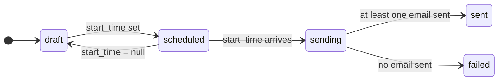

# Campaigns

A **campaign** ties everything together: an identity to send from, a subject, a template, and an audience of subscribers and groups. It goes out at its `start_time`.

## Lifecycle



`status` and `failure_reason` are set by the system. You drive scheduling with `start_time`: set it to schedule, change it to reschedule, set it to `null` to cancel.

## Build one

1. **Create the campaign** with a name, subject and identity:

   ```bash
   curl -X POST https://api.example.com/campaigns \
     -H "Authorization: Bearer $MR_KEY" -H "Content-Type: application/json" \
     -d '{ "name": "November newsletter", "subject": "Hi {{subscriber_first_name}}", "identity_id": "<identity id>" }'
   ```

2. **Add a template** with `POST /campaigns/:campaign_id/templates`. A campaign can hold several templates; the most recently updated one is sent. See [Templates and variables](./templates.md).
3. **Add the audience**:
   - subscribers directly, with `POST /campaigns/:campaign_id/subscribers`,
   - groups, with `POST /campaigns/:campaign_id/groups`. Manage a group's members with `/groups/:group_id/subscribers`.
4. **Schedule** it by setting `start_time` (an ISO timestamp) with `PATCH /campaigns/:campaign_id`.

## Who receives it

The audience is the campaign's directly linked subscribers plus every member of its linked groups, **each person once**. Subscribers who have [unsubscribed](./tracking-and-unsubscribe.md) are always left out.

A subscriber can be in any number of groups. `{{group_name}}` lists all of them.

## How sending works

When `start_time` arrives:

1. A delivery row is written for each subscriber in the audience (`pending`).
2. The list is split into chunks of 25, sent in parallel but throttled to `SES_SEND_RATE_PER_SECOND`.
3. Each subscriber gets their own email with variables filled in. A subscriber with a missing variable is marked `failed` and skipped.
4. When every chunk has finished, the campaign becomes `sent` if at least one email went out, or `failed` if none did.

A chunk that fails is retried up to five times; retries never send twice to the same subscriber. A single failed chunk doesn't block the rest of the campaign.

## Results

`GET /campaigns/:campaign_id/stats` returns:

| Field | Meaning |
| --- | --- |
| `total`, `pending`, `sent`, `failed` | Delivery counts |
| `opened`, `clicked`, `unsubscribed` | Unique subscribers (needs [tracking](./tracking-and-unsubscribe.md)) |
| `open_rate`, `click_rate` | Fractions of `sent` |

## Time zones

The organization has one IANA time zone (default UTC, set with `PATCH /organization`). The web app shows every date in it and you enter start times in it. Timestamps are absolute, so changing the zone never moves a scheduled send.

## Deleting

Deleting a campaign cancels its pending send, removes its send history, and keeps its templates, groups and subscribers (unlinked). A campaign that is mid-send can't be deleted.
