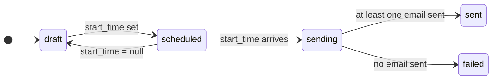

# Campaigns

A **campaign** ties everything together: an identity to send from, a subject, a template, and an audience of subscribers and groups. It goes out at its `start_time`.

## Lifecycle



`status` and `failure_reason` are set by the system. You drive scheduling with `start_time`: set it to schedule, change it to reschedule, set it to `null` to cancel.

## Build one

Templates, groups and subscribers are shared libraries: create them once, and any number of campaigns can use them. A campaign is then set up in one go, on one page in the web app or in one request through the API.

1. **Fill the libraries** (once, reused afterwards): templates with `POST /templates` (see [Templates and variables](./templates.md)), subscribers with `POST /subscribers` (or many at once with `POST /subscribers/import`; the web app imports a CSV), and groups with `POST /groups`. Add people to a group with `POST /groups/:group_id/subscribers`, or by sending `group_ids` on the subscriber or on the import.
2. **Create the campaign** with everything it needs:

   ```bash
   curl -X POST https://api.example.com/campaigns \
     -H "Authorization: Bearer $MR_KEY" -H "Content-Type: application/json" \
     -d '{
       "name": "November newsletter",
       "subject": "Hi {{subscriber_first_name}}",
       "identity_id": "<identity id>",
       "template_id": "<template id>",
       "group_ids": ["<group id>"],
       "subscriber_ids": ["<subscriber id>"],
       "start_time": "2026-11-20T09:00:00Z"
     }'
   ```

   Leave `start_time` out to save a draft. A campaign needs an identity and a template before it can be scheduled.

   With a **domain** identity, also give the address to send from: `"from_local_part": "notifications"` sends from `notifications@<domain>`. It's required for a domain identity and not allowed for an email one, which sends from itself. Either kind can add a display name, `"from_name": "Mail Rocket"`, which inboxes show as `Mail Rocket <notifications@example.com>`. See [Sender address](#sender-address).

3. **Change it** with `PATCH /campaigns/:campaign_id`. `group_ids` and `subscriber_ids` replace the whole list when sent; `start_time` schedules, reschedules, or (as `null`) cancels. The template and audience can't change once the send has started.


## Sender address

| Identity | `from_local_part` | Sends from |
| --- | --- | --- |
| email `news@example.com` | leave unset | `news@example.com` |
| domain `example.com` | `notifications` | `notifications@example.com` |
| domain `example.com` | unset | rejected (400) |

- `from_local_part` takes letters, digits and `. _ % + -`, up to 64 characters, with no dot at the start, at the end or twice in a row.
- `from_name` is optional, up to 64 characters, with no line breaks. Names with accents or emoji work.
- The address doesn't need a mailbox to send, but replies to it bounce unless it has one (or forwarding).
- Switching a campaign to an email identity clears its `from_local_part`. The web app's campaign form shows the domain after the address field and previews what inboxes will show.

## Who receives it

The audience is every member of the campaign's groups plus anyone it picked individually, **each person once**. Subscribers who have [unsubscribed](./tracking-and-unsubscribe.md) are always left out. `GET /campaigns/:campaign_id/subscribers` lists it, and the campaign's **Audience** tab in the web app shows why each person is included.

A template or group can't be deleted while a scheduled or sending campaign uses it.

A subscriber can be in any number of groups. `{{group_name}}` lists all of them.


## How sending works

When `start_time` arrives:

1. A delivery row is written for each subscriber in the audience (`pending`).
2. The list is split into chunks of 25, sent in parallel but throttled to `SES_SEND_RATE_PER_SECOND`.
3. Each subscriber gets their own email with variables filled in. A subscriber with a missing variable is marked `failed` and skipped.
4. When every chunk has finished, the campaign becomes `sent` if at least one email went out, or `failed` if none did.

A chunk that fails is retried up to five times; retries never send twice to the same subscriber. A single failed chunk doesn't block the rest of the campaign.

## Results

`GET /campaigns/:campaign_id/stats` returns:

| Field | Meaning |
| --- | --- |
| `total`, `pending`, `sent`, `failed` | Delivery counts |
| `opened`, `clicked`, `unsubscribed` | Unique subscribers (needs [tracking](./tracking-and-unsubscribe.md)) |
| `open_rate`, `click_rate` | Fractions of `sent` |


## Time zones

The organization has one IANA time zone (default UTC, set with `PATCH /organization`). The web app shows every date in it and you enter start times in it. Timestamps are absolute, so changing the zone never moves a scheduled send.

## Deleting

Deleting a campaign cancels its pending send, removes its send history, and keeps its templates, groups and subscribers (unlinked). A campaign that is mid-send can't be deleted.
