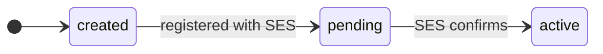

# Sending identities

An **identity** is who a campaign sends as: a whole **domain** (`example.com`) or a single **email address** (`news@example.com`). SES has to verify it before anything can be sent from it. Creating and changing identities needs an `admin` key.

## Lifecycle



Only `active` identities can send. Status is set by the system; you can't change it through the API.

## Add an identity

```bash
curl -X POST https://api.example.com/identities \
  -H "Authorization: Bearer $MR_KEY" -H "Content-Type: application/json" \
  -d '{ "type": "domain", "identity": "example.com" }'
```

- **Email identity:** SES sends a verification email to that address. Click the link in it.
- **Domain identity:** the response includes `verification_records`: a TXT record proving ownership and three DKIM CNAME records. Add them at your DNS provider. The web app shows them on the identity's page, ready to copy. Once verified, a campaign can send from any address on the domain, with no mailbox needed: it sets the part before the @ (see [Sender address](./campaigns.md#sender-address)).

## Verification

Verification is asynchronous: DNS can take minutes or days. Each identity gets its own background job that asks SES for its status every few minutes and reschedules itself until SES confirms. Then the identity becomes `active`. There's no attempt limit; the poll stops when SES confirms or when you delete the identity.

`type` and `identity` can't be changed after creation. To use a different domain or address, create a new identity.

:::note SES sandbox
A new SES account is in the **sandbox**: it can only send to verified addresses. To send to anyone, request production access in the SES console. See [AWS SES setup](../deployment/aws-ses.md).
:::


